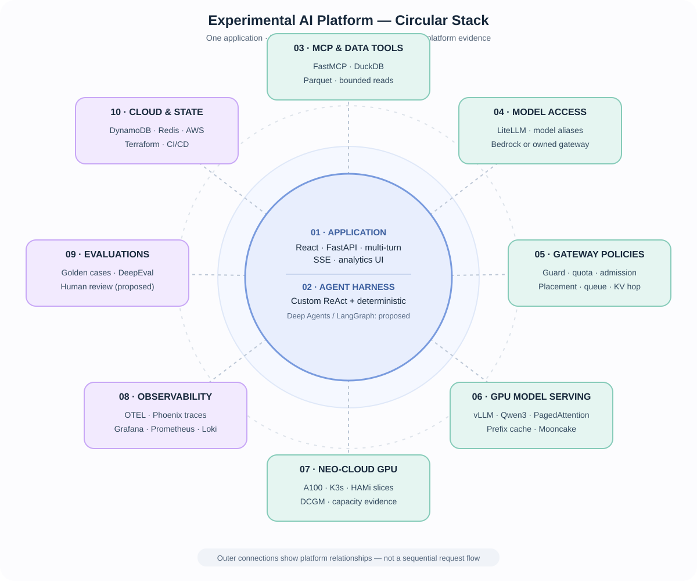

# Experimental AI Platform Engineering

An open-source **NYC Taxi analytics copilot** and experimental platform for studying how agents behave, how to evaluate them, and how to serve models under real GPU constraints.

## The application

Ask questions about millions of NYC taxi trips in natural language. A **React + FastAPI** app uses **read-only FastMCP tools** backed by **DuckDB/Parquet** to produce grounded analytics. It supports **multi-turn conversation**, model **token/delta streaming where supported**, **SSE execution events and replay**, tool-use timelines, cancellation, and durable run state in **DynamoDB** with **Redis** for transient coordination. The opt-in Deep Agents path currently emits completed answers rather than streaming answer tokens.

## Agent harness experiments

**Built:** application-owned deterministic and bounded **ReAct** orchestration (tool loops, context reduction, budgets, retries, cancellation), plus an opt-in **Deep Agents/LangGraph** strategy.

**Benchmark direction:** custom ReAct **vs Deep Agents**, then **large vs small planner models** (e.g. Nova Pro vs Micro), holding tools and tasks constant. Compare tool-selection correctness, answer quality, task completion, latency, and **cost per correct answer**.

## Evaluation & observability tools we built

| Tool | Purpose |
| --- | --- |
| **[Evaluation harness](tooling/evals/)** | Versioned **37-case golden dataset**, deterministic/recorded judges, captured-run replay, and regression reports. The cases still need human approval. |
| **[Human review workbench](tooling/evals/src/evals/review_server.py)** | Save tool/answer/resolution verdicts, review disagreements, and inspect evidence; **plan scoring is next**. |
| **[Phoenix trace integration](docs/observability-stack.md)** | Link reviews to **OpenTelemetry traces** spanning app, MCP and LiteLLM; Grafana/Prometheus/Loki cover operational metrics and logs. |
| **[Model policy engine](services/app/app/model_policy/)** | Planner/answer aliases, tenant entitlements, token limits, and spend controls. |

**Next:** calibrate automated judges against human verdicts; score **plan, tool, and answer** separately.

## Inference platform & experiments

**Built:** an owned **[model gateway](services/gateway/)** with guards, tenant quotas, admission/shedding, prefix-aware placement, per-worker queues and KV-hop/overflow decisions. **vLLM/Qwen** runs on an **A100 with K3s/HAMi**; a separate **LiteLLM → Bedrock** path supports hosted models.

**Repeatable inference workloads:** The [scenario replay tool](tooling/benchmarks/) generates fixed-prefix, multi-turn agent traffic, including CrewAI-shaped workloads, to exercise realistic prefill/decode pressure and cache reuse. The workload generator is distinct from the agent-harness quality benchmark.

**Inference comparisons:**
- **Capacity:** KV memory vs decode slots vs queues; cold vs warm worker.
- **Placement/cache:** least-loaded vs prefix-aware routing; first-pass vs reused prefix.
- **Overload:** admission on vs off, measuring goodput, p99, fairness and shed reasons.
- **KV locality:** local reuse vs recompute vs LMCache/Mooncake transfer.

**Next:** stronger self-hosted vs managed inference comparisons, GPU efficiency and cost per successful request.

## Engineering deep dives — as built

Each document describes **current behavior, code ownership, limitations, and evidence**. Exploratory designs and possible future implementations remain separate in [research](docs/research/context/README.md).

| Area | Implementation documentation |
| --- | --- |
| **Application & MCP evidence retrieval** | [Context engineering, SQL observations, context reducer, and follow-up history](docs/architecture/context-engineering-and-evidence.md) |
| **Agent harness & prompt contracts** | [Custom orchestration and overall architecture](DESIGN.md) · [Prompt/prefix contract](docs/prefix-contract.md) |
| **Evaluation & human review** | [Eval pipeline and human review](docs/evals.md) · [Capture format](docs/capture.md) |
| **Model access & governance** | [LiteLLM integration](docs/litellm-proxy.md) · [Model roles and spend policies](docs/model-policy.md) |
| **Inference gateway & GPU serving** | [Gateway implementation](services/gateway/README.md) · [Inference experiments and measured evidence](docs/inference-experiments/inference-evidence-index.md) |
| **Telemetry and operations** | [Observability setup](docs/observability-stack.md) · [Local operation](docs/local-uat-guide.md) |

[Inference runs](docs/inference-experiments/inference-experiments-reference.md) · [GPU measurements](docs/inference-experiments/evidence/notebook/) · [Eval limitations](docs/evals.md) · [Architecture](DESIGN.md) · [Run locally](docs/local-uat-guide.md)

