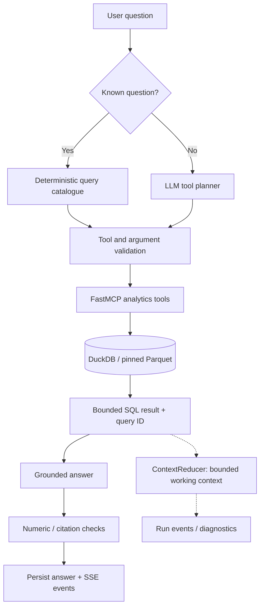

# RAG & MCP Tools Architecture

The NYC Taxi analytics assistant uses **retrieval-augmented generation over structured data**: the agent retrieves results from read-only MCP tools backed by DuckDB/Parquet, then generates an answer grounded in those results. This is **SQL/tool-based RAG**, not document RAG; it does not use chunking, embeddings, or a vector index.

## Retrieval and answer flow

The dotted path matters: **the ContextReducer produces a working-context record, but the answer model's prompt is assembled separately**. Reduced observations are not guaranteed to replace the full current query result in every model path.

## Implemented modules

| Module | Responsibility |
| --- | --- |
| **Query catalogue** | Maps recognized questions to fixed tool calls without a planner model request. Other questions use the model planner. |
| **MCP tool layer** | Exposes validated read-only analytics; callers cannot submit arbitrary SQL or dataset paths. |
| **DuckDB retrieval** | Runs allowlisted analytical queries against the pinned January 2024 taxi dataset and zone lookup. |
| **Result validation** | Checks tool output shape, row/byte limits, and safe failure envelopes before evidence reaches orchestration. |
| **ContextReducer** | Retains recent messages, summarizes older history, and records up to three preview rows plus evidence references and remaining budgets. |
| **Answer grounding** | Checks numeric claims and query IDs against returned evidence; flags causal claims the dataset cannot establish. |

## MCP tool catalogue

| Tool | Purpose |
| --- | --- |
| `get_dataset_profile` | Dataset identity and profile metadata |
| `describe_taxi_dataset` | Schema, coverage and code dictionaries |
| `list_taxi_dimension_values` | Valid values for a supported dimension |
| `query_taxi_data` | Fixed analyses such as popular pickup zones and peak hours |
| `average_trip_metrics` | Regional fare and distance metrics |
| `aggregate_taxi_data` | Grouped measures, filters, sorting and limits |
| `compare_taxi_segments` | Compare two filtered populations |

The MCP server also publishes the dataset schema as a **resource**. Analytical tools enforce input schemas and bounded results; they are not a general-purpose SQL execution endpoint.

## Conversation context

| Agent/model path | Follow-up behavior |
| --- | --- |
| **Custom ReAct + LiteLLM/Bedrock** | Planner receives the current question rather than prior Q/A and tool history. |
| **Custom ReAct + owned vLLM** | Includes stored conversation and tool evidence; history rendering is not bounded. |
| **Deep Agents** | Restores a bounded selection of prior turns and tool observations, with tool content marked as untrusted. |

## Next improvement

**Multi-turn query resolution:** Interpret follow-ups such as “compare that with the second-highest zone” using the preceding question, filters, and retrieved evidence **before selecting the next MCP tool**. This is not yet a dedicated, consistent stage across model paths.

**Implementation:** [MCP server](../../services/mcp/mcp_server/server.py) · [Tool schemas](../../services/mcp/mcp_server/schemas.py) · [Query catalogue](../../services/app/app/query_catalogue.py) · [MCP client](../../services/app/app/mcp_client.py) · [ContextReducer](../../services/app/app/orchestration/reducer.py) · [Grounding](../../services/app/app/validation/grounding.py).
