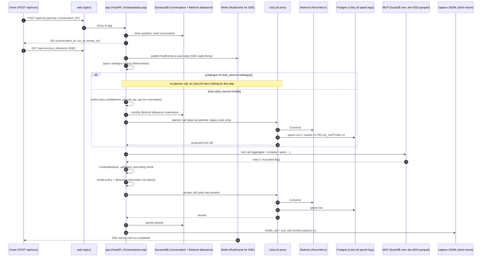

# Evaluation foundations

Scope: the offline `tooling/evals/` slice of #171, plus real `capture.v1` ingest and the session report (#176). The live direct-Bedrock vs LiteLLM comparison is still a follow-up.

**Status: the baseline/candidate/regressed fixtures (traces, run manifests, recorded judge scores) are synthetic. `fixtures/captured/` holds one recorded real-shaped session produced by the real loop with a scripted provider (NOT live Bedrock). All 37 golden cases are `pending_human_review`.** Nothing here is a live model observation or a human-approved reference yet.

## Feedback loop

1. **Observe**: runs emit `capture.v1` JSONL (one record per model or tool call, joined by `run_id`).
2. **Triage**: failures and expensive or slow runs are clustered; interesting ones become *candidate*
   cases. Production/demo observations are never golden by themselves.
3. **Review**: a human writes the reference SQL, `evals refresh-reference` computes the expected facts
   on the pinned parquet, and the case lands in `datasets/golden/<version>/` through a PR. A model
   answer or model SQL is never ground truth.
4. **Grade**: deterministic graders (numeric facts, tool arguments, step budget, evidence present,
   limitation stated, no fabricated numbers) run on every PR over recorded fixtures. DeepEval judge
   metrics are replayed from recorded verdicts.
5. **Compare**: `evals report` diffs a candidate run against a baseline using the thresholds pinned in
   the run manifest (dataset version and hash, model alias, prompt version, judge model, thresholds).
   Regressions exit non-zero. Cost, tokens, latency and failure rate are reported next to quality.
6. **Decide and grow**: ship or reject the model/prompt change, then add reviewed cases for new
   failure clusters and bump the dataset version (never edit a released version silently).

## Dataset v1 (37 cases)

14 deterministic catalogue questions, 8 ReAct investigations, 5 multi-turn conversations, 6
unsupported/causal requests, 4 failure scenarios (tool validation error, timeout, empty result,
provider error). Every `review.status` is `pending_human_review` until the PR reviewer promotes it.
Facts use tolerances (counts 0.1%, averages 1%) and accept `23.8%` for `0.2376`.

## Judge metrics and their limits

Metrics: answer quality (GEval), tool correctness (DeepEval, deterministic), faithfulness, task
completion, step efficiency. Normal CI never calls a model: `RecordedJudge` replays stored scores.
Live scoring needs `uv sync --extra judge`, `EVALS_LIVE_JUDGE=1` and a judge model; it costs money and
is unverified against a real judge in this slice.

- Judges are probabilistic, drift across judge-model versions, and favour fluent or long answers.
  Treat scores as a screening signal, not ground truth; deterministic graders gate numeric claims.
- Compare runs only under the same judge model and version (stored in the manifest).
- Faithfulness here uses the reviewed reference facts as evidence because `capture.v1` stores row
  counts and query ids, not raw tool results. It does not detect a correct number that the run never
  retrieved; the `evidence_present` check covers that.
- Judge-vs-human calibration needs a hand-labeled set; not done yet. Recorded judge scores in
  `fixtures/` are synthetic.
- Small dataset: a one-case swing moves pass rate ~2.7 points. Thresholds are initial guesses.

## Captured traffic: candidate -> reviewed golden -> comparison (#176)

Real `capture.v1` JSONL has `run_id`/`turn_id`/`call_id`/`conversation_id` but no `case_id`/`turn_index`.

1. `evals candidates --traces captured.jsonl` (needs question text, i.e. a capture made with `CAPTURE_CONTENT=1`; metadata-only captures have no text to match and must be linked by a human-written matches file) lists each run with *suggested* golden turns (exact question match; may be several). A suggestion is not a label.
2. A human writes a matches file (`evals.matches.v1`: `run_id`, `case_id`, `turn_index`, `confirmed_by`). Validation rejects unknown cases, bad turn indexes, a missing `confirmed_by`, and duplicate runs or targets.
3. `resolve()` grades a matched run only if the golden case is `review.status == "reviewed"`. Runs that are unmatched, or matched to a still-pending case, stay *candidate only* and are not graded. `--provisional` grades against pending references and the report is then marked PROVISIONAL.
4. `evals session-report --traces ... --matches ... [--conversation-id ID] [--provisional]` writes the per-session report: answer correctness, tool behavior (actual vs expected), tokens, cost, latency. LIVE is derived only from the `execution_mode` recorded in the capture and requires every record to say `live`; anything else (scripted, unverified, missing) prints NOT LIVE. `--origin live` is only a cross-check and is refused when the capture is not recorded as live. The file must hold exactly one conversation, or select one with `--conversation-id`; otherwise the command errors. Unknown tokens/cost render `n/a` and totals are marked as lower bounds.

`build_turns()` no longer raises on unlinked records; it skips them (use `build_run_views()` for raw capture). Tool status `completed` (the app) and `ok` (synthetic) both count as success.

`fixtures/captured/taxi-session.jsonl` is a two-turn session (`multi-001`) recorded by `services/app/tests/capture_session_fixture.py`: real `OrchestrationLoop`, `LiteLLMClient`, model policy/pricing and capture recorder; scripted provider (httpx mock) and scripted MCP. Answers, token counts and latency are scripted, so correctness passing is by construction; it proves the pipeline, not model quality. `matches.json` there is fixture wiring by the agent, not a golden review. `report.md` is the PROVISIONAL report for it. Replace with a live Bedrock capture (same commands; it reports LIVE only if the capture was recorded with `CAPTURE_EXECUTION_MODE=live`, which is an operator assertion made at capture time) once a run is available.

## Running a live baseline

A live baseline runs the golden cases through the real app path (LiteLLM -> Bedrock -> MCP) and freezes the raw evidence so a later change can be compared against it. It measures the system as shipped; it does not change prompts, tools, models, or golden values. Results are **provisional** until the cases are human-reviewed.

### What a turn touches



| Component | Kind | Role in a baseline | Holds |
|---|---|---|---|
| Driver | local script | Submits each turn, waits for a terminal event, records IDs. No retries. | `results.jsonl`, `matches.json`, event text |
| `web` | infra (nginx) | Entry point for `/api/*`. | nothing |
| `app` | service | Catalogue, planner/answer calls, MCP calls, reduction, validation, capture. Owns every LLM call and loop budget. | capture JSONL |
| DynamoDB | AWS | Durable conversation state and the shared monthly Bedrock allowance. | conversations, allowance |
| Redis | infra | Transient RunEvent fan-out for SSE only; never durable. | nothing durable |
| LiteLLM + Postgres | service + infra | Model alias routing, budgets, per-call spend rows, optional request/response bodies. | `LiteLLM_SpendLogs` |
| Bedrock | AWS | The model. | AWS billing |
| `mcp` | service | Governed read-only analytics tools over the pinned parquet. Never calls an LLM. | nothing |
| `worker` | service | Async job consumer; not on the `/api/runs` path. | nothing |

Catalogue-served turns make no planner call, so LiteLLM holds fewer rows than there are turns; the app capture is the complete per-run record.

### Procedure

1. **Freeze inputs.** Record the git commit, dataset hash (`datasets/golden/<version>/cases.jsonl`), LiteLLM config hash, container image IDs, model aliases, and prompt template versions. Do not edit code, prompts, tools, models, or golden values during the baseline or the later AFTER run.
2. **Bring the stack up** from the checkout under test with app capture on (`CAPTURE_DIR`, `CAPTURE_EXECUTION_MODE=live`, `CAPTURE_CONTENT=1`; see [capture](capture.md)) and, if proxy bodies are wanted, `LITELLM_CAPTURE=1` (see [LiteLLM proxy](litellm-proxy.md)). Check `make litellm-ready` and `/api/status`. Confirm `LLM_PROVIDER=litellm`.
3. **Smoke one run** (`make litellm-smoke`) and confirm the capture record carries `prompt_template_id`, version, hash, and `execution_mode=live`.
4. **Estimate and agree spend** before the full run, and watch the monthly allowance (`GLOBAL_BEDROCK_MONTHLY_LIMIT_USD`). Stop if provider errors become systematic or the environment changes.
5. **Drive every case once.** One new conversation per case; reuse the returned `conversation_id` for later turns of the same case. For each turn: `POST /api/runs`, read `GET /api/runs/{run_id}/events` to a terminal event, and record `case_id`, `turn_index`, `conversation_id`, `run_id`, and the terminal event. Do not retry or rerun cases to improve scores; keep every failure.
6. **Snapshot the evidence.** Copy the capture file, make it read-only, and store its sha256. Keep the event streams.
7. **Write the matches file** (`evals.matches.v1`) from the driver's `results.jsonl`, then grade with `evals session-report --provisional --conversation-id <id>`, one conversation at a time.
8. **Analyse each turn.** Read the answer against the tool rows (events: `context.reduced` -> `working_context.recent_messages`), not just the grader output.

### Identifiers and sources of truth

There is no single baseline ID unless the driver sends one: pass the label as `eval_run_id` (`POST /api/runs` body field, or header `x-eval-run-id`; `^[A-Za-z0-9._:-]{1,64}$`). The driver's `results.jsonl` stays the index for `case_id`/`turn_index`.

| ID | In | Notes |
|---|---|---|
| `eval_run_id` | capture records, every run event, LiteLLM `request_tags` (`eval_run_id:<id>`) and `metadata.spend_logs_metadata`, `ai.run` span attribute | opt-in batch label; correlation only, never an auth/tenant/billing boundary |
| `conversation_id` | driver, capture, events, LiteLLM as `session_id` | one per case |
| `run_id` | driver, capture, events, LiteLLM `spend_logs_metadata.run_id` | one per turn |
| `call_id` | capture `call_id` = event `llm_call_id` = LiteLLM `spend_logs_metadata.call_id` | one logical model call |
| `(call_id, attempt)` | LiteLLM `spend_logs_metadata` | one physical proxy request; a policy fallback gives one capture record several rows, and a failed attempt may emit none. Join capture -> spend as 1:N and sum `spend` per row. |
| `trace_id` | capture `trace_id`, Jaeger | one per run (`ai.run`); joins app, MCP and LiteLLM spans when the stack runs with `LITELLM_OTEL=1` |
| `case_id`, `turn_index` | driver, matches file | not in capture or LiteLLM |
| LiteLLM `request_id` | LiteLLM | proxy-generated; unrelated to `call_id` |

**Correlating an eval run** (verified live, 2 cases, see work-history 0110):

1. Start the stack with `LITELLM_OTEL=1 make local-aws-litellm-compose` plus app capture.
2. Capture: select JSONL records with `eval_run_id == <id>`; `record_type == "model_call"` rows carry `call_id` and `trace_id`.
3. Events: every run event has `eval_run_id`; `llm.completed` carries `llm_call_id`.
4. LiteLLM: `GET /spend/logs` (no date params, master key) and keep rows whose `request_tags` contains `eval_run_id:<id>`; read `metadata.spend_logs_metadata.{run_id, call_id, attempt}`.
5. Jaeger: `GET http://127.0.0.1:16686/api/traces/<capture trace_id>`; the trace holds `ai-analytics-app`, `analytics-mcp` and `litellm-proxy` spans.

Expected invariants: every capture `call_id` has at least one spend row, every tagged spend row maps to a capture `call_id`, and `(call_id, attempt)` is unique among the rows actually emitted.

| Need | Source |
|---|---|
| Billed cost per call | LiteLLM `spend` (capture `cost_usd` agrees); AWS billing is final |
| Request/response bodies, proposed tool calls | LiteLLM `/spend/logs` (only with `LITELLM_CAPTURE=1`) |
| Executed tool arguments, status, latency, answer, prompt version | app capture JSONL |
| Tool result rows | run events (`context.reduced`) |

`/spend/logs` returns raw rows only when called without `start_date`/`end_date`; with them it returns daily aggregates. Use `/spend/logs/ui` for paged lists and `?request_id=` for one full row. The `cost_usd` inside run events is an app-side estimate and has been about 100x the capture/proxy cost; do not use it.

### Reading the results honestly

- `run.completed` means the workflow finished, not that the answer is right. Report execution, tool correctness, and answer correctness separately.
- Check `tool_source` in the `step.llm_proposal` event: `catalogue` turns test the deterministic catalogue; `model` turns test the planner, which today is offered only the legacy tools and always emits a tool call.
- The deterministic graders can pass a wrong answer (numbers present but mislabelled or incomplete) and fail an acceptable one. Treat the pass rate as a legacy score until the graders check label association, completeness, and required arguments.
- Mark cases with incompatible reference semantics (for example `multi-001`, `fail-003`) diagnostic, with the reason, instead of silently dropping them. Genuine model failures stay in the metrics.

## Grading outcomes and basis tags

**Tag vocabulary** (case-level `tags`, additive; golden values are never changed by tagging):

- `basis-dependent` plus exactly one of `basis:legacy_unfiltered` (legacy `query_taxi_data`, `average_trip_metrics`, `describe_taxi_dataset`: no valid-records filter), `basis:governed_valid_records` (`aggregate_taxi_data`, `compare_taxi_segments`, `list_taxi_dimension_values`) or `basis:mixed` (turns use tools from both bases). A basis-dependent reference can legitimately differ from another tool's answer to the same question, so reports separate cases by basis.
- `diagnostic`: graded and listed separately, excluded from aggregate rates and gates (reason in the case `notes`).
- `fault-injection`: the scenario needs an injected tool or provider failure and cannot be executed live; it is reported in its own section and excluded from live rates.

**Three separate outcomes** per turn: execution (did the workflow finish), tool (right tool and required arguments, or an accepted equivalent) and answer (facts, labels, completeness). Each is `correct`, `incorrect`, `needs_review` or `not_applicable`. `needs_review` is never counted as pass or fail; it has its own column and is resolved by a human.

**Tool output source**: `capture.v1` does not carry tool results, so checks that need them read an optional run-events directory (`context.reduced` events, joined by query id). Without it those checks report `needs_review` or `not_applicable`, never a silent pass.

**Grader v2 checks**:
- `required_args` / `forbidden_args`: verifies expected tool call arguments strictly beyond simple subset matching.
- `_truncated_incomplete`: detects truncated tool evidence (`truncated=True` or `row_count == limit`) on non-ranking queries and ensures the model does not present partial results as complete.
- `check_entity_value_association`: enforces clause/token window proximity between entity labels and numeric values.
- `check_comparative_claims`: verifies superlative/comparative claims (e.g. longest, shortest, highest) against actual row values.
- `ungrounded_numbers`: ensures numbers in answers originate from tool result rows rather than model hallucination.
- `tool_equivalence`: when a different tool provides verified reference values (e.g. `multi-004#0`), tool outcome is marked `needs_review` while answer is evaluated on its own.

**CLI usage**:
```bash
uv run --project tooling/evals evals session-report \
  --traces <traces.jsonl> \
  --matches <matches.json> \
  --events-dir <path_to_events> \
  --provisional
```

## Live eval runs (issue #200)

A live golden run is one folder under `metrics/evals/` (gitignored, like `metrics/inference/`). `run_id = <label>-<UTC timestamp>`; `make eval-start` **refuses a label that already has a run**, so a finished eval is never silently repeated or overwritten. Output of every `eval-*` target is kept in the run's `logs/`.

```text
metrics/evals/
  .current                    run_id of the active run
  _capture/                   fixed capture mount of the app container (all runs); each run filters it by exact eval_run_id
  <run_id>/
    manifest.json             label, run_id, git head, dataset sha256, web url, cases
    results.jsonl matches.json one row per turn / confirmed golden matches (driver output)
    events/<run_id>.txt       SSE event logs (tool output for the grader)
    smoke/                    optional smoke run, never mixed into results
    captures.snapshot.jsonl   capture.v1 lines for this run only, plus .sha256
    report/<conversation>.md  grader output, one per conversation
    compare.md review.html    comparison with a frozen baseline / human-readable per-turn review
    logs/<target>-<ts>.log    every make target's output (+ <target>.latest.log)
```

```bash
make eval-stack-up                         # once: stack with live capture (LITELLM_OTEL=1 adds Jaeger)
make eval-start LABEL=<name>               # new run, fails if the label was used before
make eval-health
make eval-smoke EVAL_CONFIRM=1             # one real case (det-001), a few tokens
make eval-run EVAL_CONFIRM=1               # full golden set, real Bedrock
make eval-freeze eval-grade
make eval-compare EVAL_BASELINE=<regrade_results.jsonl>
make eval-cost eval-review eval-open
# or all at once (compare is skipped when EVAL_BASELINE is unset):
make eval-all LABEL=<name> EVAL_CONFIRM=1 [EVAL_BASELINE=...]
```

**Failed and interrupted runs.** `run-live` checkpoints every turn (`results.jsonl`, `matches.json`) and keeps `state.json` (`running`, `incomplete` or `complete`; `complete` only when every expected case and turn of the manifest has a recorded row with complete evidence, `missing_turns` lists the rest) and journals each submitted run id to `submitted.jsonl` before waiting for events. A turn that ends in `run.failed` or `run.cancelled` is a *measured result* and is graded normally. A turn with no terminal event (submit error, timeout, broken stream) is *incomplete evidence*: `run-live` exits 3, `eval-all` stops, and `freeze`, `grade`, `compare` and `review` refuse until the run is `complete` (or `--allow-incomplete`). Re-running without `--resume` is refused; `evals run-live --resume` keeps fully recorded cases and re-runs the rest in a fresh conversation, moving the abandoned rows to `results.superseded.jsonl` (`run-freeze` keeps only capture lines whose `run_id` is a checkpointed result, so superseded and never-recorded attempts are dropped and orphans are listed). In a multi-turn case, turns after a `run.failed` or `run.cancelled` turn still run (so turn counts stay comparable) and are marked `after_failed_turn` in `results.jsonl`, so cascades can be separated from genuine follow-up failures. Grader output is also written as `report/<conversation>.json`; `compare` and `review` read the JSON, not the Markdown. `compare` classifies each change as improved, regressed, lateral (different value, equal rank), unchanged or missing_evidence.

`EVAL_CONFIRM=1` is required for every target that calls real Bedrock. `EVAL_RUN=<run_id>` selects a run other than `.current`. `eval_run_id` is a correlation label, not an authorization or billing boundary. `eval-cost` shows LiteLLM spend for the whole stack lifetime; the run's own capture cost is in `report/`.

**Failure codes (#186).** `run.failed` carries a `failure_code`; `run-compare` and `run-review` show a per-run histogram of them (read from the run's events), so a change in failure mix is visible without grepping events. Codes seen on the golden set: `no_tool_call` (planner replied without a tool call), `multiple_tool_calls`, `mcp_tool_error`, `litellm_proxy_http_<status>` for unclassified proxy errors, and `malformed_tool_use`: a planner call that Bedrock rejected with "Model produced invalid sequence as part of ToolUse" (LiteLLM relays it as HTTP 424). `malformed_tool_use` is not retried and has no fallback alias. Its `run.failed` payload and run metadata carry `provider_error` = `{category, provider_status, provider_call_id, attempts}` (never the provider body or the prompt), and the failed attempt is an `LLMCall` with null usage and cost: the run budget is charged the existing conservative bound (or fails closed when the alias is unpriced) while the reported run tokens and cost stay unchanged. The span event `ai.llm_call` gains `ai.llm.error_category` and `ai.llm.provider_status`, and the run span `ai.error.category`.

## Planner model comparison: Nova Micro vs Nova Pro (#207)

Not yet run: each full golden run is paid Bedrock traffic and needs your `EVAL_CONFIRM=1`. Run both with the same prompt version (`planner-single-turn@1.2.0`) and the same dataset so the model is the only change:

```bash
# Pro (the default mapping in infra/litellm/config.yaml)
make eval-stack-up
make eval-all LABEL=207-pro EVAL_CONFIRM=1

# Micro: use an untracked copy of the proxy config with taxi-planner -> bedrock/amazon.nova-micro-v1:0,
# mounted over /app/config.yaml, then restart the stack and run the same label pattern
make eval-all LABEL=207-micro EVAL_CONFIRM=1
make eval-compare EVAL_RUN=<pro run> EVAL_BASELINE=<micro run>/regrade_results.jsonl
```

Read from `compare.md` / `review.html`: tool and argument correctness (matches, `failure_code` histogram incl. `multiple_tool_calls` and `tool_validation_error`), completion success (answered vs failed vs declined), latency, and cost. Cost per successful query is the run's `report/` cost divided by its answered turns (calculate it by hand; the tooling does not print it). Record the result and any case that could not run in `docs/work-history/0120-nova-pro-planner.md`.

## Known gaps

- A first live provisional baseline exists only as local, uncommitted evidence; the committed session report is local-scripted. Its legacy grader score is not a trusted quality metric.
- `multi-001` carries the `diagnostic` tag: it is graded and listed in a separate "Diagnostic cases" section of delta reports, but excluded from the aggregate pass rate, tool-correctness mean, per-category rates and regression gates. It is retained for query-resolution (#110) diagnosis until the filter contract between `query_taxi_data` and the governed tools is reconciled. Its turn 2 asserts the entities (nested subset match on `baseline_filters`/`comparison_filters`: JFK Airport vs Midtown Center); subset matching recurses into nested objects, `exact` still requires identical keys.
- Golden cases are all pending human review, so strict mode grades nothing; reviewing `multi-001` is the next human step.
- Matching is manual by design; there is no automatic promotion of captured runs to golden cases.

Fixtures are synthetic, so no real model quality or cost decision is supported yet. The `app_runs` direct vs LiteLLM rerun, quality-qualified goodput joined with the benchmark SLO
goodput (here: pass rate only), failure clustering and judge calibration are follow-ups.

## Human review of a frozen run (#190)

Verdicts are stored beside the frozen evidence in `<run>/reviews.jsonl` (append-only, schema v1, bound to the run id and `captures.snapshot.sha256`); the evidence, golden cases and grader reports are never edited. A modified snapshot blocks reading and writing reviews.

1. `make eval-review-serve REVIEWER=<name> [EVAL_RUN=<run_id>] [EVAL_BASELINE=<results.jsonl>] [REVIEW_PORT=8765]` serves the review page on `127.0.0.1` only. Each turn has a tool / answer / resolution verdict (`correct`, `incorrect`, `needs_review`) plus notes; save writes to `reviews.jsonl`. The page filters by unreviewed and by grader/human disagreement; grader outcomes stay in their own column.
2. Re-reviewing a turn appends a new record; the latest `reviewed_at` wins and the earlier ones stay in the file as superseded. Duplicate ids, malformed lines and records bound to other evidence are reported, never applied.
3. `evals run-review-export` writes `<run>/reviews.resolved.json` (verdicts, disagreements, unreviewed turns, malformed/stale/duplicate counts); `evals.reviews.load_human_verdicts` imports it. `evals run-review-add` records one verdict from the command line.

The static `review.html` from `make eval-review` is unchanged. Phoenix deep links are not part of this page yet.
