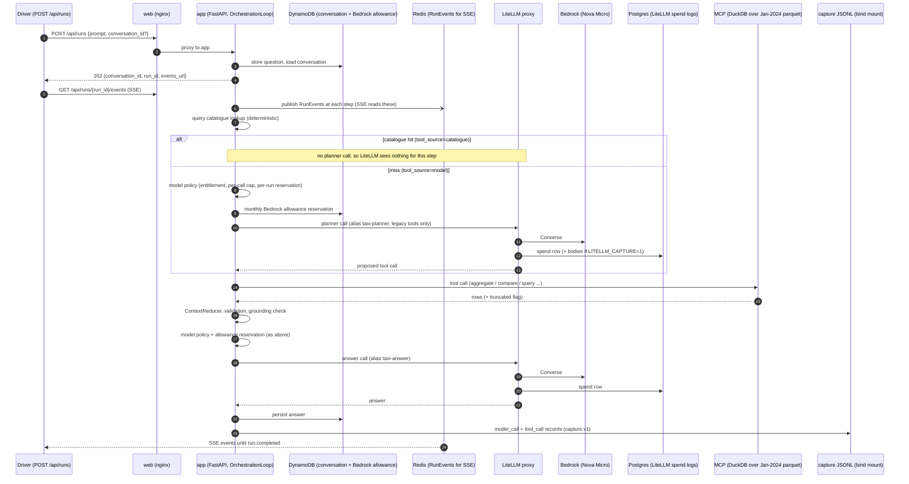

# Running baselines and model comparisons

[Evaluation documentation index](../evals.md)

## Running a live baseline

A live baseline runs the golden cases through the real app path (LiteLLM -> Bedrock -> MCP) and freezes the raw evidence so a later change can be compared against it. It measures the system as shipped; it does not change prompts, tools, models, or golden values. Results are **provisional** until the cases are human-reviewed.

### What a turn touches



| Component | Kind | Role in a baseline | Holds |
|---|---|---|---|
| Driver | local script | Submits each turn, waits for a terminal event, records IDs. No retries. | `results.jsonl`, `matches.json`, event text |
| `web` | infra (nginx) | Entry point for `/api/*`. | nothing |
| `app` | service | Catalogue, planner/answer calls, MCP calls, reduction, validation, capture. Owns every LLM call and loop budget. | capture JSONL |
| DynamoDB | AWS | Durable conversation state and the shared monthly Bedrock allowance. | conversations, allowance |
| Redis | infra | Transient RunEvent fan-out for SSE only; never durable. | nothing durable |
| LiteLLM + Postgres | service + infra | Model alias routing, budgets, per-call spend rows, optional request/response bodies. | `LiteLLM_SpendLogs` |
| Bedrock | AWS | The model. | AWS billing |
| `mcp` | service | Governed read-only analytics tools over the pinned parquet. Never calls an LLM. | nothing |
| `worker` | service | Async job consumer; not on the `/api/runs` path. | nothing |

Catalogue-served turns make no planner call, so LiteLLM holds fewer rows than there are turns; the app capture is the complete per-run record.

### Procedure

1. **Freeze inputs.** Record the git commit, dataset hash (`datasets/golden/<version>/cases.jsonl`), LiteLLM config hash, container image IDs, model aliases, and prompt template versions. Do not edit code, prompts, tools, models, or golden values during the baseline or the later AFTER run.
2. **Bring the stack up** from the checkout under test with app capture on (`CAPTURE_DIR`, `CAPTURE_EXECUTION_MODE=live`, `CAPTURE_CONTENT=1`; see [capture](../capture.md)) and, if proxy bodies are wanted, `LITELLM_CAPTURE=1` (see [LiteLLM proxy](../litellm-proxy.md)). Check `make litellm-ready` and `/api/status`. Confirm `LLM_PROVIDER=litellm`.
3. **Smoke one run** (`make litellm-smoke`) and confirm the capture record carries `prompt_template_id`, version, hash, and `execution_mode=live`.
4. **Estimate and agree spend** before the full run, and watch the monthly allowance (`GLOBAL_BEDROCK_MONTHLY_LIMIT_USD`). Stop if provider errors become systematic or the environment changes.
5. **Drive every case once.** One new conversation per case; reuse the returned `conversation_id` for later turns of the same case. For each turn: `POST /api/runs`, read `GET /api/runs/{run_id}/events` to a terminal event, and record `case_id`, `turn_index`, `conversation_id`, `run_id`, and the terminal event. Do not retry or rerun cases to improve scores; keep every failure.
6. **Snapshot the evidence.** Copy the capture file, make it read-only, and store its sha256. Keep the event streams.
7. **Write the matches file** (`evals.matches.v1`) from the driver's `results.jsonl`, then grade with `evals session-report --provisional --conversation-id <id>`, one conversation at a time.
8. **Analyse each turn.** Read the answer against the tool rows (events: `context.reduced` -> `working_context.recent_messages`), not just the grader output.

### Identifiers and sources of truth

There is no single baseline ID unless the driver sends one: pass the label as `eval_run_id` (`POST /api/runs` body field, or header `x-eval-run-id`; `^[A-Za-z0-9._:-]{1,64}$`). The driver's `results.jsonl` stays the index for `case_id`/`turn_index`.

| ID | In | Notes |
|---|---|---|
| `eval_run_id` | capture records, every run event, LiteLLM `request_tags` (`eval_run_id:<id>`) and `metadata.spend_logs_metadata`, `ai.run` span attribute | opt-in batch label; correlation only, never an auth/tenant/billing boundary |
| `conversation_id` | driver, capture, events, LiteLLM as `session_id` | one per case |
| `run_id` | driver, capture, events, LiteLLM `spend_logs_metadata.run_id` | one per turn |
| `call_id` | capture `call_id` = event `llm_call_id` = LiteLLM `spend_logs_metadata.call_id` | one logical model call |
| `(call_id, attempt)` | LiteLLM `spend_logs_metadata` | one physical proxy request; a policy fallback gives one capture record several rows, and a failed attempt may emit none. Join capture -> spend as 1:N and sum `spend` per row. |
| `trace_id` | capture `trace_id`, Phoenix | one per run (`ai.run`); joins app, MCP and LiteLLM spans when the stack runs with `LITELLM_OTEL=1` |
| `case_id`, `turn_index` | driver, matches file | not in capture or LiteLLM |
| LiteLLM `request_id` | LiteLLM | proxy-generated; unrelated to `call_id` |

**Correlating an eval run** (verified live, 2 cases, see work-history 0110):

1. Start the stack with `LITELLM_OTEL=1 make local-aws-litellm-compose` plus app capture.
2. Capture: select JSONL records with `eval_run_id == <id>`; `record_type == "model_call"` rows carry `call_id` and `trace_id`.
3. Events: every run event has `eval_run_id`; `llm.completed` carries `llm_call_id`.
4. LiteLLM: `GET /spend/logs` (no date params, master key) and keep rows whose `request_tags` contains `eval_run_id:<id>`; read `metadata.spend_logs_metadata.{run_id, call_id, attempt}`.
5. Phoenix: `GET http://127.0.0.1:16006/v1/projects/default/spans?trace_id=<capture trace_id>`; the trace holds `ai-analytics-app`, `analytics-mcp` and `litellm-proxy` spans.

Expected invariants: every capture `call_id` has at least one spend row, every tagged spend row maps to a capture `call_id`, and `(call_id, attempt)` is unique among the rows actually emitted.

| Need | Source |
|---|---|
| Billed cost per call | LiteLLM `spend` (capture `cost_usd` agrees); AWS billing is final |
| Request/response bodies, proposed tool calls | LiteLLM `/spend/logs` (only with `LITELLM_CAPTURE=1`) |
| Executed tool arguments, status, latency, answer, prompt version | app capture JSONL |
| Tool result rows | run events (`context.reduced`) |

`/spend/logs` returns raw rows only when called without `start_date`/`end_date`; with them it returns daily aggregates. Use `/spend/logs/ui` for paged lists and `?request_id=` for one full row. The `cost_usd` inside run events is an app-side estimate and has been about 100x the capture/proxy cost; do not use it.

### Reading the results honestly

- `run.completed` means the workflow finished, not that the answer is right. Report execution, tool correctness, and answer correctness separately.
- Check `tool_source` in the `step.llm_proposal` event: `catalogue` turns test the deterministic catalogue; `model` turns test the planner, which today is offered only the legacy tools and always emits a tool call.
- The deterministic graders can pass a wrong answer (numbers present but mislabelled or incomplete) and fail an acceptable one. Treat the pass rate as a legacy score until the graders check label association, completeness, and required arguments.
- Mark cases with incompatible reference semantics (for example `multi-001`, `fail-003`) diagnostic, with the reason, instead of silently dropping them. Genuine model failures stay in the metrics.


## Live eval runs (issue #200)

A live golden run is one folder under `metrics/evals/` (gitignored, like `metrics/inference/`). `run_id = <label>-<UTC timestamp>`; `make eval-start` **refuses a label that already has a run**, so a finished eval is never silently repeated or overwritten. Output of every `eval-*` target is kept in the run's `logs/`.

```text
metrics/evals/
  .current                    run_id of the active run
  _capture/                   fixed capture mount of the app container (all runs); each run filters it by exact eval_run_id
  <run_id>/
    manifest.json             label, run_id, git head, dataset sha256, web url, cases
    results.jsonl matches.json one row per turn / confirmed golden matches (driver output)
    events/<run_id>.txt       SSE event logs (tool output for the grader)
    smoke/                    optional smoke run, never mixed into results
    captures.snapshot.jsonl   capture.v1 lines for this run only, plus .sha256
    report/<conversation>.md  grader output, one per conversation
    compare.md review.html    comparison with a frozen baseline / human-readable per-turn review
    logs/<target>-<ts>.log    every make target's output (+ <target>.latest.log)
```

```bash
make eval-stack-up                         # once: stack with live capture (LITELLM_OTEL=1 routes traces through the Collector; JAEGER=1 adds Jaeger)
make eval-start LABEL=<name>               # new run, fails if the label was used before
make eval-health
make eval-smoke EVAL_CONFIRM=1             # one real case (det-001), a few tokens
make eval-run EVAL_CONFIRM=1               # full golden set, real Bedrock
make eval-freeze eval-grade
make eval-compare EVAL_BASELINE=<regrade_results.jsonl>
make eval-cost eval-reconcile eval-review eval-open
# or all at once (compare is skipped when EVAL_BASELINE is unset):
make eval-all LABEL=<name> EVAL_CONFIRM=1 [EVAL_BASELINE=...]
```

**Failed and interrupted runs.** `run-live` checkpoints every turn (`results.jsonl`, `matches.json`) and keeps `state.json` (`running`, `incomplete` or `complete`; `complete` only when every expected case and turn of the manifest has a recorded row with complete evidence, `missing_turns` lists the rest) and journals each submitted run id to `submitted.jsonl` before waiting for events. A turn that ends in `run.failed` or `run.cancelled` is a *measured result* and is graded normally. A turn with no terminal event (submit error, timeout, broken stream) is *incomplete evidence*: `run-live` exits 3, `eval-all` stops, and `freeze`, `grade`, `compare` and `review` refuse until the run is `complete` (or `--allow-incomplete`). Re-running without `--resume` is refused; `evals run-live --resume` keeps fully recorded cases and re-runs the rest in a fresh conversation, moving the abandoned rows to `results.superseded.jsonl` (`run-freeze` keeps only capture lines whose `run_id` is a checkpointed result, so superseded and never-recorded attempts are dropped and orphans are listed). In a multi-turn case, turns after a `run.failed` or `run.cancelled` turn still run (so turn counts stay comparable) and are marked `after_failed_turn` in `results.jsonl`, so cascades can be separated from genuine follow-up failures. Grader output is also written as `report/<conversation>.json`; `compare` and `review` read the JSON, not the Markdown. `compare` classifies each change as improved, regressed, lateral (different value, equal rank), unchanged or missing_evidence.

`EVAL_CONFIRM=1` is required for every target that calls real Bedrock. `EVAL_RUN=<run_id>` selects a run other than `.current`. `eval_run_id` is a correlation label, not an authorization or billing boundary. `eval-cost` shows LiteLLM spend for the whole stack lifetime; the run's own capture cost is in `report/`.

**Billing reconciliation (#226).** After `eval-freeze`, with the stack still up (`/spend/logs` returns recent rows only), `make eval-reconcile` saves the proxy's spend rows to `<run>/spend_logs.json` and runs `evals run-reconcile`, which keeps rows tagged `eval_run_id:<run_id>`, joins them to the frozen capture by `call_id` (summing several rows per call for fallbacks and retries) and writes `report/spend_reconciliation.json`. It exits 4 and prints `VIOLATION:` lines when a capture call has no spend row, a `(call_id, attempt)` repeats among any tagged row (matched or orphan, so a repeated orphan cannot inflate the cost), a tagged row lacks `call_id` or an integer `attempt` (it cannot be deduplicated), a provider-billed capture cost differs from its spend, or no tagged rows exist at all (the report then has `ok: false`, not just a non-zero exit). A tagged row with no capture call is an *orphan*: typically a request still in flight when its run was cancelled or abandoned. Orphans are not a failure but are billed spend the run record never saw, so `reconciled_cost_usd` (matched spend plus orphans) is the cost to use for cost-per-correct-answer (#228), not the sum of run `estimated_cost_usd`. Calls whose capture cost is not provider-billed are counted in `estimated_calls` and are not cost-compared.

**Trace continuity (#226).** `make eval-trace-check` (after `eval-freeze`, Phoenix up) queries Phoenix's REST API for each run's capture `trace_id` and writes `report/trace_check.json`. Per run it requires exactly one `ai.run` root with `ai.run_id` (matching the capture), `ai.status`, `agent.strategy`, `agent.framework` and `agent.step_count`; the `ai.run` span to be the parentless trace root and every other span to descend from it (a missing parent, a parent cycle or a second root fails); one `trace_id` per capture run (conflicting ids fail without querying); at least as many `litellm_proxy_request` spans as capture model calls and `mcp.tool.execute` spans as *completed* capture tool calls (a failed call can be rejected before the tool runs and emit none; all 43 real runs checked matched on completed calls). It exits 4 with `PROBLEM:` lines on any gap, and 2 if Phoenix cannot be queried: an empty trace, a capture without `trace_id` or an unreachable Phoenix never pass. Span names are what Phoenix exports (its span payload has no service name). Runs recorded before #241 lack the `agent.*` attributes and will be flagged for that.

**Run budgets (#226).** Every run is capped by `ExecutionBudgets` (defaults: 20,000 input tokens summed over the run's model calls, 5 tool calls, 6 model calls, 5 iterations, 60 s; cost cap 0.50 USD and output cap fixed). The defaults were sized for the manual path (about 2 model calls). Deep Agents re-sends the whole conversation and every tool schema on each call (about 6k input tokens before any history), so a single detour such as a wrong zone name, a dimension-value lookup and a retry exceeds 20,000 and ends the run as `budget_exceeded`. `run-live` records `run.budget_exceeded` as a complete terminal outcome (it is not `run.completed`, so graders and `run-compare` count it as a failure), later turns of that case still run with `after_failed_turn`, and the failure histogram lists it as `budget_exceeded`. The app reads optional overrides at boot: `AGENT_MAX_INPUT_TOKENS`, `AGENT_MAX_TOOL_CALLS`, `AGENT_MAX_LLM_CALLS`, `AGENT_MAX_ITERATIONS`, `AGENT_TIMEOUT_SECONDS`. Blank or unset keeps the default; a non-positive or non-numeric value stops the app at boot, so an override cannot be silently ignored. Overrides apply to every run of that stack, so label a run made with them (for example `deep-agents-highcap`) and record the values in the run notes: a comparison against a baseline taken under the defaults is then a different budget policy, not only a different strategy. Example: `AGENT_STRATEGY=deep_agents AGENT_MAX_INPUT_TOKENS=40000 AGENT_MAX_TOOL_CALLS=8 make eval-stack-up`.

**Deep Agents prompt size and tool errors (#226).** In the first full Deep Agents runs the per-call prompt was about 6k input tokens, three quarters of it tool definitions, and 5 of 10 budget stops were the repeated-call guard, not the token cap: the model sent `aggregate_taxi_data` without `dimensions`, got only `{"error": "invalid_arguments"}`, and repeated the identical call. Now (1) an invalid call returns a `message` saying which argument is wrong (`dimensions is required and must be a non-empty list ...`), (2) the tool schemas sent to the model drop `anyOf [X, null]` and `default: null` noise and mark the non-empty arrays `minItems: 1`, keeping every property, constraint and description, and (3) the planning tool `write_todos` is opt-in with `AGENT_PLANNING=1` (it was used in 1 of 43 turns and cost about 1k tokens per call; run metadata `offered_tools` shows which tools were offered). Compare runs made before and after as different prompt configurations.

**Grader v3.** Subset tool matching treats an omitted argument that equals the tool's default as present (`include_column_stats: false`, the default `limit` 20, `order_by.direction: desc`; table in `evals.graders.TOOL_ARG_DEFAULTS`). On the first Deep Agents runs this changed 2 of about 25 tool mismatches and 0 for the manual run, which always sends its defaults. `match: exact` stays strict. Reports now say `provisional grader v3`; regrade older runs before comparing them with new ones.

**Failure codes (#186).** `run.failed` carries a `failure_code`; `run-compare` and `run-review` show a per-run histogram of them (read from the run's events), so a change in failure mix is visible without grepping events. Codes seen on the golden set: `no_tool_call` (planner replied without a tool call), `multiple_tool_calls`, `mcp_tool_error`, `litellm_proxy_http_<status>` for unclassified proxy errors, and `malformed_tool_use`: a planner call that Bedrock rejected with "Model produced invalid sequence as part of ToolUse" (LiteLLM relays it as HTTP 424). `malformed_tool_use` is not retried and has no fallback alias. Its `run.failed` payload and run metadata carry `provider_error` = `{category, provider_status, provider_call_id, attempts}` (never the provider body or the prompt), and the failed attempt is an `LLMCall` with null usage and cost: the run budget is charged the existing conservative bound (or fails closed when the alias is unpriced) while the reported run tokens and cost stay unchanged. The span event `ai.llm_call` gains `ai.llm.error_category` and `ai.llm.provider_status`, and the run span `ai.error.category`.


## Planner model comparison: Nova Micro vs Nova Pro (#207)

Not yet run: each full golden run is paid Bedrock traffic and needs your `EVAL_CONFIRM=1`. Run both with the same prompt version (`planner-single-turn@1.2.0`) and the same dataset so the model is the only change:

```bash
# Pro (the default mapping in infra/litellm/config.yaml)
make eval-stack-up
make eval-all LABEL=207-pro EVAL_CONFIRM=1

# Micro: use an untracked copy of the proxy config with taxi-planner -> bedrock/amazon.nova-micro-v1:0,
# mounted over /app/config.yaml, then restart the stack and run the same label pattern
make eval-all LABEL=207-micro EVAL_CONFIRM=1
make eval-compare EVAL_RUN=<pro run> EVAL_BASELINE=<micro run>/regrade_results.jsonl
```

Read from `compare.md` / `review.html`: tool and argument correctness (matches, `failure_code` histogram incl. `multiple_tool_calls` and `tool_validation_error`), completion success (answered vs failed vs declined), latency, and cost. Cost per successful query is the run's `report/` cost divided by its answered turns (calculate it by hand; the tooling does not print it). Record the result and any case that could not run in `docs/work-history/0120-nova-pro-planner.md`.

