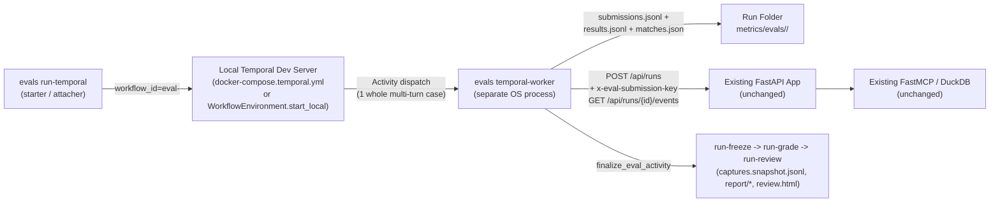

# Opt-In Temporal Eval Workflow Pilot (#253)

This document records the opt-in local Temporal pilot for offline golden-dataset evaluations (`tooling/evals/`), its real OS-process `SIGKILL` crash-recovery proofs, a side-by-side comparison against the existing file-checkpointed `evals run-live --resume` CLI, and an evidence-backed **keep / stop** recommendation.

## Architecture and Ownership Boundaries

Temporal is strictly **local and opt-in** under `tooling/evals/`. Online request execution (`FastAPI -> MCP`), Redis `app.worker`, DynamoDB durable state, LiteLLM proxy routing, and base `docker-compose.yml` are unchanged.



### Key invariants

- **Deterministic workflow boundary (`tooling/evals/src/evals/temporal_pilot.py`):** `EvalBatchWorkflow` runs inside Temporal's default workflow sandbox with zero direct network calls, zero filesystem I/O, and zero per-tool Temporal retry layers.
- **Scheduling unit = whole multi-turn case:** Each golden case (1–3 turns sharing one `conversation_id`) runs inside one `execute_case_activity` invocation with periodic heartbeating so worker death is detected promptly without falsely timing out legitimate multi-second LLM turns.
- **No blind retries (`tooling/evals/src/evals/temporal_store.py`):** Every turn is keyed deterministically by `submission_key = "<eval_run_id>:<case_id>:t<turn_index>"` and tracked with fsynced appends in `<run_dir>/submissions.jsonl` under an exclusive `fcntl.flock` lock:
  1. **Already complete in `results.jsonl`:** skipped with zero HTTP calls.
  2. **`accepted` in `submissions.jsonl` (post-accept crash before Activity ack):** skips `POST /api/runs`, reconciles via `GET /api/runs/{run_id}/events` (SSE replay), and continues later turns in the same `conversation_id`.
  3. **`submitting` with no `accepted` (blind-window crash between HTTP POST and receiving `202`):** queries optional `GET /api/runs/by-submission/{submission_key}`. If the server returns `200 {run_id, conversation_id}`, reconciles via SSE; if the server returns `404`/`405`/`501` (current unmodified `services/app`), records `terminal="ambiguous_submission"`, `evidence="incomplete"`, and stops the case **without retrying `POST /api/runs`**.
- **Artifact compatibility:** Writes the exact run-folder schema (`submitted.jsonl`, `results.jsonl`, `matches.json`, `events/<run_id>.txt`, `state.json`) consumed by `evals run-freeze`, `run-grade`, `run-reconcile`, `run-trace-check`, and `run-review`.
- **Known pilot boundaries:**
  - **Single-run scope:** This pilot orchestrates **one** eval run through case execution, freeze, grade, and review — it does not yet orchestrate both arms of a matched A/B experiment (tracked separately).
  - **Manual spend reconciliation:** Spend reconciliation (`make eval-reconcile`) and Phoenix trace checking (`make eval-trace-check`) remain manual post-run steps rather than part of `--finalize`, because `/spend/logs` requires `LITELLM_MASTER_KEY` against the live proxy.
  - **Stream timeouts:** A completed SSE call that ends in `timeout` or `stream_error` is recorded in `results.jsonl` as `evidence="incomplete"` and leaves that case incomplete rather than auto-replaying SSE on resume.
  - **Per-case concurrency guard:** Overlapping worker attempts for the same case are prevented by an exclusive non-blocking per-case lock (`<run_dir>/.locks/<case_id>.lock`), and torn JSONL tails are repaired atomically on disk under lock before appending.
- **Optional dependency isolation:** `temporalio>=1.20,<2` is isolated under `[project.optional-dependencies] temporal` (and `[dependency-groups] dev` so CI executes the crash-recovery proof). Default `evals` commands never import `temporalio`.

## Real OS-Process `SIGKILL` Crash-Recovery Proof

`tooling/evals/tests/test_temporal_pilot.py` runs against a real local Temporal server (`WorkflowEnvironment.start_local()`, Temporal CLI 1.10.1 / Server 1.32.2), a local fixture HTTP server simulating `/api/runs`, replayable SSE `/api/runs/{id}/events`, `capture.v1` JSONL emission, and separate OS child worker processes (`evals temporal-worker`) terminated mid-flight with `os.kill(pid, signal.SIGKILL)`. All three scenarios use three real golden cases (`det-001`, 2-turn `multi-001`, and `det-004` — 4 turns total) with `finalize=True`:

| Scenario | Crash Point (`SIGKILL`) | Server Lookup Endpoint | Observed `POST /api/runs` Calls | Observed Recovery & Report Outcome |
| --- | --- | --- | --- | --- |
| **1. Post-accept crash before Activity ack** | Worker #1 completed `det-001`, persisted `accepted` for `multi-001#0`, then killed mid-SSE before Activity ack | Disabled (`404`) | **4 total** (1 per turn; `det-001` not rerun, `multi-001#0` not resubmitted) | Worker #2 reconciled `multi-001#0` via SSE replay, preserved `conversation_id` into `multi-001#1`, completed `det-004`, set `state.json` to `complete`, and produced one graded report (`captures.snapshot.jsonl`, `report/*.json/.md`, `review.html`) covering all 4 turns. |
| **2. Blind-window crash without server lookup** | Worker #1 sent `POST /api/runs` for `multi-001#0`; app recorded it, Worker #1 killed before receiving `202` | Disabled (`404`, current `services/app`) | **3 total** (`det-001#0`: 1, `multi-001#0`: **1 — no blind retry**, `multi-001#1`: 0, `det-004#0`: 1) | Worker #2 got `404` from lookup, recorded `multi-001#0` as `terminal="ambiguous_submission"` / `evidence="incomplete"`, completed `det-004`, marked `state.json` `incomplete`, and skipped freeze/grade cleanly. |
| **3. Blind-window crash with server lookup** | Identical blind-window kill before receiving `202` | Enabled (`200`) | **4 total** (1 per turn; zero duplicate submissions) | Worker #2 resolved `(run_id, conversation_id)` via `GET /api/runs/by-submission/{key}`, journaled `accepted` (`source="lookup"`), replayed SSE, finished `multi-001#1` and `det-004`, and produced one complete graded report. |

## Side-by-Side Comparison: Temporal Pilot vs `evals run-live --resume`

| Dimension | Existing `evals run-live --resume` | Opt-in Temporal Pilot (`run-temporal`) |
| --- | --- | --- |
| **Operational footprint** | Single local Python CLI process; zero extra services | Requires Temporal server (`docker-compose.temporal.yml` or dev CLI) + separate `evals temporal-worker` process + `evals run-temporal` starter |
| **Crash detection & restart** | Manual operator re-invocation (`evals run-live --resume`) | Automatic heartbeat-timeout detection (`--heartbeat-timeout`) and activity retry on replacement worker |
| **Post-accept mid-case crash** | Drops incomplete case to `results.superseded.jsonl` and re-runs the whole multi-turn case in a fresh conversation (leaves earlier turn as a billed orphan in LiteLLM) | Reconciles accepted `run_id` via SSE replay without re-calling `POST /api/runs` and continues later turns in the same `conversation_id` (zero orphan spend for post-accept crashes) |
| **Blind-window crash (before `202` persisted)** | Cannot detect whether app accepted the request; `--resume` re-runs the case (risks duplicate billed run) | Safely detects `submitting` without `accepted`; without server lookup, marks `ambiguous_submission` and refuses blind retry (prevents duplicate spend, still needs manual resolution); **full automatic recovery requires an app-side submission key** |
| **Workflow & run supervision** | Terminal stdout + `logs/` + `state.json` | Temporal Web UI (`http://127.0.0.1:8233`), durable workflow history, deterministic `workflow_id=eval-<run_id>` attach, plus identical run-folder artifacts |
| **End-to-end finalization** | Separate manual commands (`eval-freeze`, `eval-grade`, `eval-review`) or `make eval-all` | Optional `--finalize` executes freeze/grade/review automatically once all cases complete cleanly |
| **Debuggability on small batches (37 cases / 43 turns)** | Trivial single-process stack traces and immediate restart | Extra failure surfaces (Temporal server health, task queue mismatch, worker process lifecycle, workflow sandbox rules) |

## Explicit Keep / Stop Recommendation

**Decision: KEEP strictly as an opt-in pilot; STOP before making Temporal the default eval runner or deploying Temporal infrastructure.**

Grounded reasons from this pilot:

1. **Temporal alone does not eliminate duplicate-spend risk on blind-window crashes.** Scenario 2 proves that until `services/app` accepts and indexes a client submission key (e.g., `x-eval-submission-key` -> `(run_id, conversation_id)`), Temporal cannot safely reconcile a crash between `POST /api/runs` transmission and `202` persistence — the safe behavior is to halt that case as `ambiguous_submission` rather than retry. That safety property comes from the local submission journal (`temporal_store.py`), not Temporal itself.
2. **Post-accept reconciliation is genuinely better than `--resume` superseding, but does not require Temporal at 37 cases.** The biggest cost-saving win in Scenario 1 (replaying `GET /api/runs/{id}/events` for an accepted `run_id` instead of superseding the entire multi-turn case) lives inside `temporal_store.py` and could be adopted directly by `run-live --resume` without running a Temporal server.
3. **Operational overhead outweighs benefits for the current POC scale.** Running a 37-case / 43-turn local golden batch sequentially takes minutes in one CLI process. Adding a Dockerized Temporal server plus a separate worker process increases local setup and troubleshooting cost without unlocking a bottleneck the POC actually hits today.

**Revisit / promote criteria (when adopting Temporal as default would pay off):**
- Eval batches grow to hundreds of multi-turn cases or multi-model matrix sweeps requiring multi-worker fan-out, scheduled unattended runs, or long-lived human-in-the-loop pause/resume across hours; **and**
- `POST /api/runs` gains a durable server-side idempotency / submission-key lookup (`GET /api/runs/by-submission/{key}`) so Scenario 3 (full zero-duplicate blind-window recovery) holds against the live app.

## Opt-In Tiny Live LiteLLM Run Procedure (`EVAL_CONFIRM=1`)

> **Cost warning:** The commands below invoke real Bedrock models via the local LiteLLM stack and are intentionally gated on `EVAL_CONFIRM=1`. They were **not** executed automatically during CI or issue verification.

Start with a 2-case subset (`det-001` + 2-turn `multi-001` = 3 turns) to verify real LiteLLM spend correlation and Phoenix traces at minimal cost:

```bash
# 1. Start the live eval stack (app + MCP + Redis + LiteLLM + Phoenix + capture volume)
make eval-stack-up

# 2. Start the opt-in standalone local Temporal dev server (localhost:7233, UI :8233)
make eval-temporal-up

# 3. In a second terminal, start the standalone Temporal eval worker process
make eval-temporal-worker

# 4. Create a new run folder scoped to the 2-case subset and check stack health (no spend)
uv run --project tooling/evals evals run-start \
  --root metrics/evals --label temporal-pilot-1 --web http://localhost:3000 \
  --cases det-001 multi-001
make eval-health

# 5. Execute the 2-case pilot through Temporal and auto-finalize freeze/grade/review (REAL BEDROCK SPEND)
make eval-temporal-run EVAL_CONFIRM=1 EVAL_CASES="det-001 multi-001" EVAL_FINALIZE=1

# 6. Reconcile LiteLLM /spend/logs and check Phoenix traces while the stack is still up
make eval-reconcile
make eval-trace-check

# 7. Stop only the opt-in Temporal server when done
make eval-temporal-down
```

Inspect the Temporal workflow execution history at `http://127.0.0.1:8233` (workflow ID `eval-<run_id>`) and the standard eval outputs under `metrics/evals/<run_id>/` (`submissions.jsonl`, `results.jsonl`, `captures.snapshot.jsonl`, `report/spend_reconciliation.json`, `review.html`).
